# CURL - Segunda Entrega
## POST y GET Géneros
_**Responsable**: Jetzaly Josmery Tello Campos_

### Crear género
```bash
curl -i -X POST "http://localhost:8081/api/genres" -H "Content-Type: application/json" -d '{"name":"Nombre"}'
```
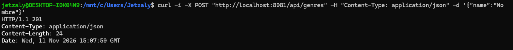

### Crear género sin nombre
```bash
curl -i -X POST "http://localhost:8081/api/genres" -H "Content-Type: application/json" -d '{}'
```
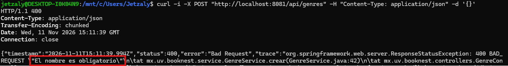

### Listar géneros
```bash
curl -i -X GET "http://localhost:8081/api/genres"
```
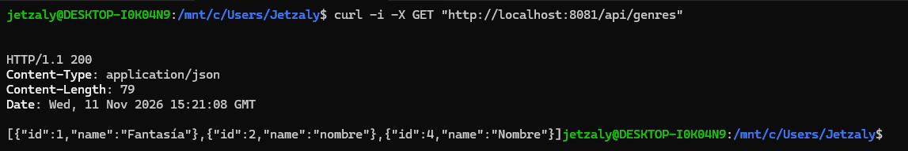

### Género que existe
```bash
curl -i -X GET "http://localhost:8081/api/genres/1"
```
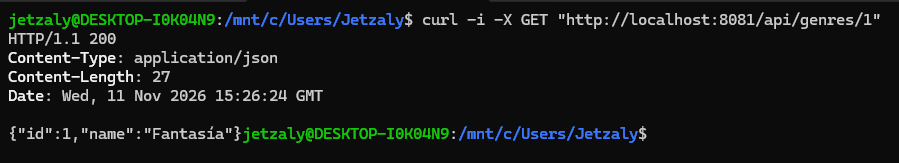

### Género que no existe
```bash
curl -i -X GET "http://localhost:8081/api/genres/5"
```
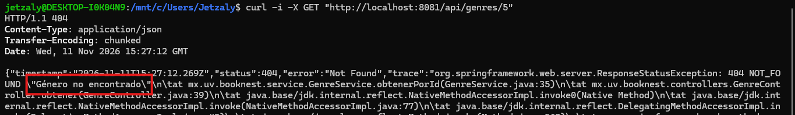

## POST y GET Autor

### Crear autor
```bash
curl -i -X POST "http://localhost:8081/api/authors" -H "Content-Type: application/json" -d '{"name":"Yo"}'
```
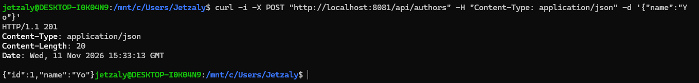

### Crear autor sin nombre
```bash
curl -i -X POST "http://localhost:8081/api/authors" -H "Content-Type: application/json" -d '{}'
```
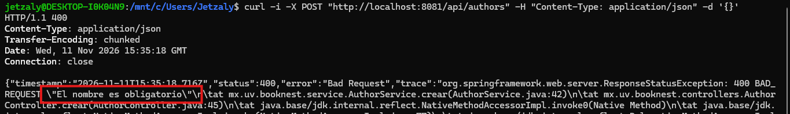

### Listar autores
```bash
curl -i -X GET "http://localhost:8081/api/authors"
```
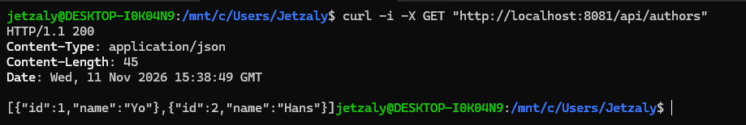

### Pedir un autor
```bash
curl -i -X GET "http://localhost:8081/api/authors/1"
```
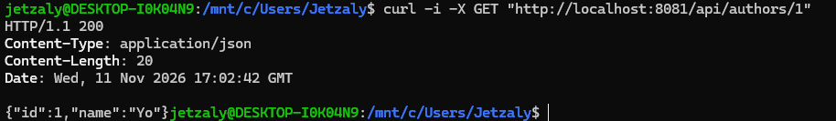

### Autor que no existe
```bash
curl -i -X GET "http://localhost:8081/api/authors/3"
```
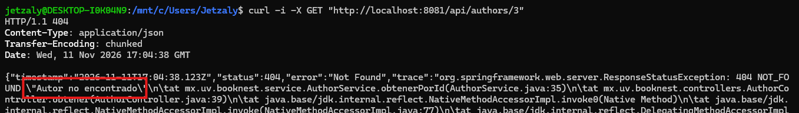

## Series

### Crear serie
```bash
curl -i -X POST "http://localhost:8081/api/series" -H "Content-Type: application/json" -d '{"name":"Harry Potter", "seriesType":"saga"}'
```
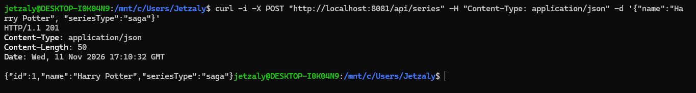

### Serie con tipo inválido
```bash
curl -i -X POST "http://localhost:8081/api/series" -H "Content-Type: application/json" -d '{"name":"Harry Potter", "seriesType":"novela"}'
```
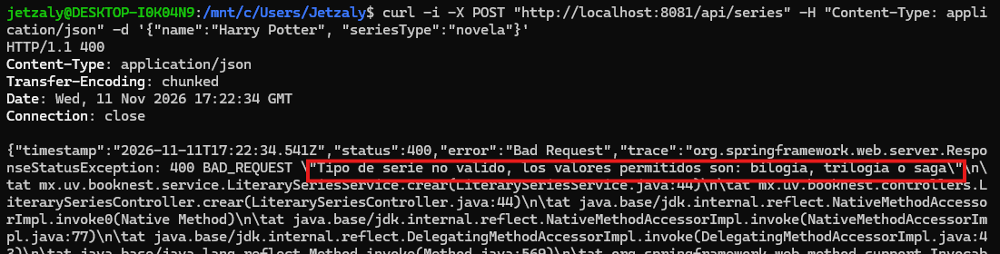

### Serie sin tipo
```bash
curl -i -X POST "http://localhost:8081/api/series" -H "Content-Type: application/json" -d '{"name":"Harry Potter"}'
```
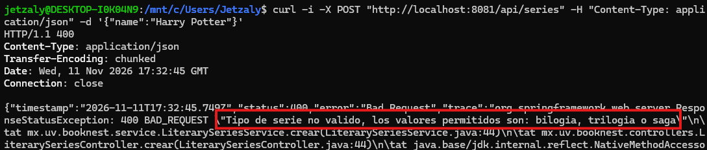

### Listar series
```bash
curl -i -X GET "http://localhost:8081/api/series"
```
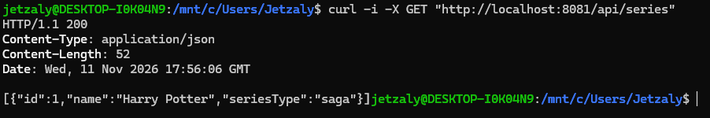

### Pedir una serie
```bash
curl -i -X GET "http://localhost:8081/api/series/1"
```
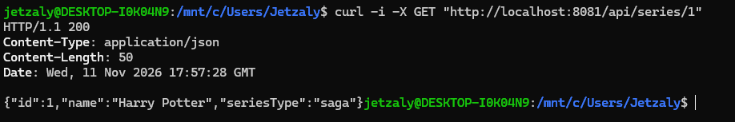

### Serie que no existe
```bash
curl -i -X GET "http://localhost:8081/api/series/3"
```
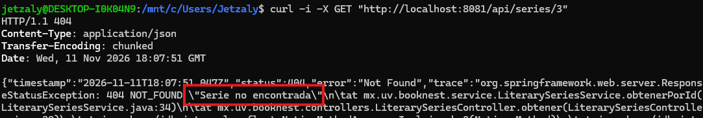

## POST y GET Libros

### Crear libro
```bash
curl -i -X POST "http://localhost:8081/api/books" -H "Content-Type: application/json" -d '{"mainTitle":"Harry Potter", "totalPages":"300"}'
```
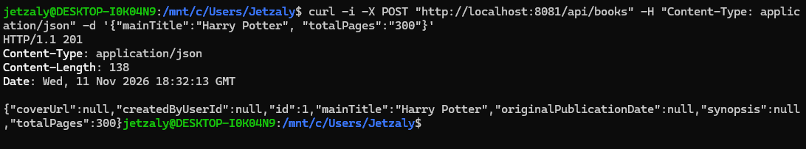

### Libro con 0 páginas
```bash
curl -i -X POST "http://localhost:8081/api/books" -H "Content-Type: application/json" -d '{"mainTitle":"Harry Potter", "totalPages":"0"}'
```
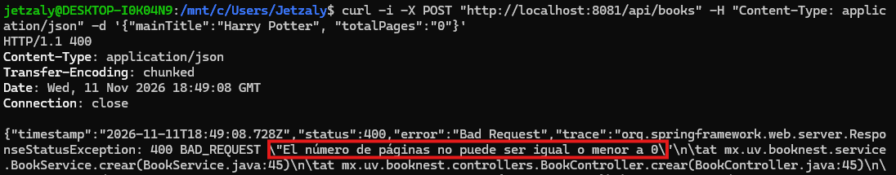

### Libro sin páginas
```bash
curl -i -X POST "http://localhost:8081/api/books" -H "Content-Type: application/json" -d '{"mainTitle":"Harry Potter"}'
```
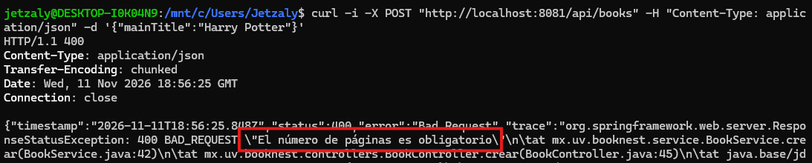

### Libro sin título
```bash
curl -i -X POST "http://localhost:8081/api/books" -H "Content-Type: application/json" -d '{"totalPages":"3"}'
```
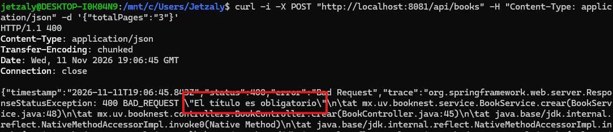

### Listar libros
```bash
curl -i -X GET "http://localhost:8081/api/books"
```
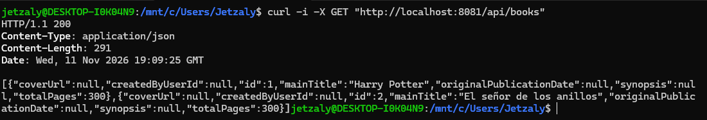

### Pedir un libro
```bash
curl -i -X GET "http://localhost:8081/api/books/1"
```
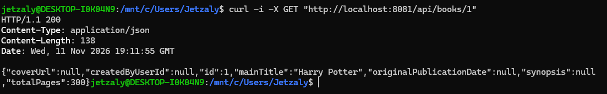

### Libro que no existe
```bash
curl -i -X GET "http://localhost:8081/api/books/3"
```
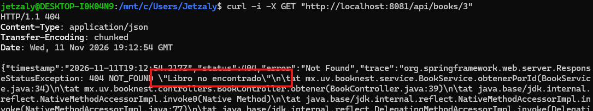