# Pruebas Interfaz
## Crear un libro y verificar que se guarde
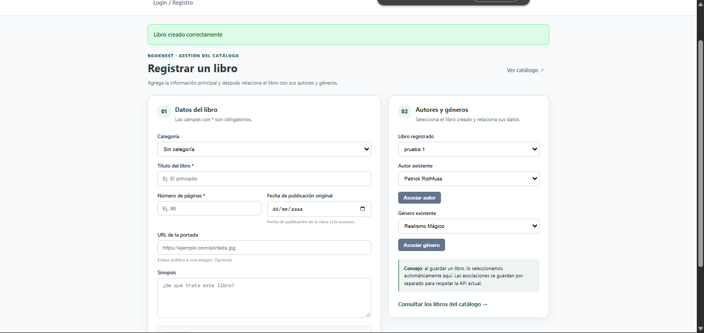
## Buscar por título, autor y título alternativo y Aplicar filtros combinados, incluida categoría

Búsqueda de ejemplo:
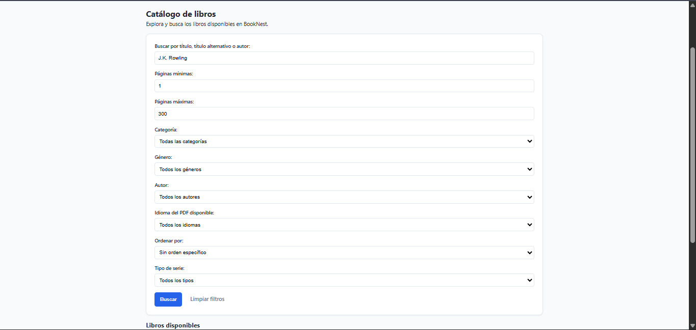
Resultado: 

## Editar un libro y comprobar los cambios
Campos editados:
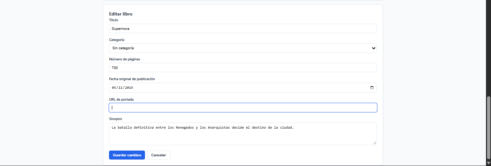

## Intentar registrar un libro duplicado
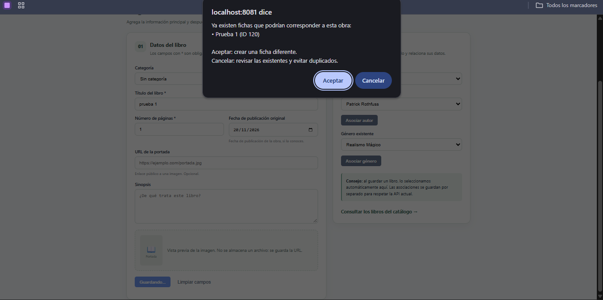
## Crear una serie y asociar varios libros en orden
Llenado:
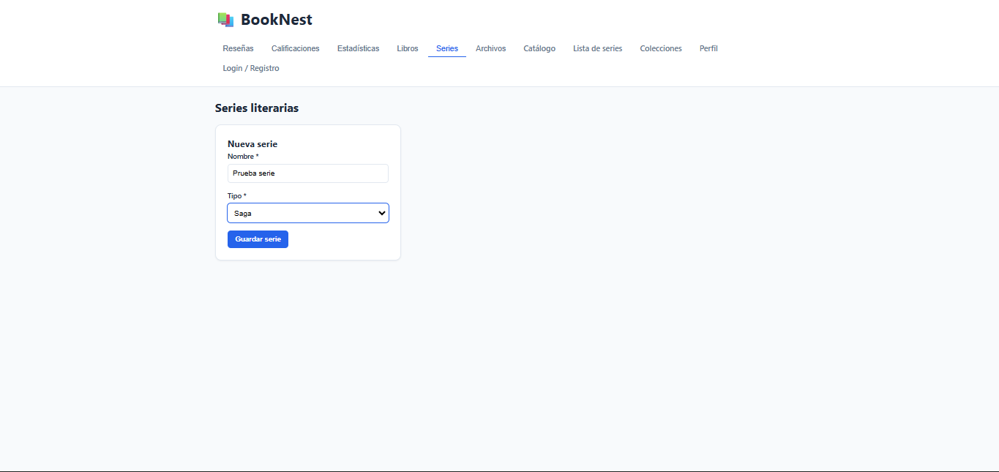
Retroalimentación del sistema:
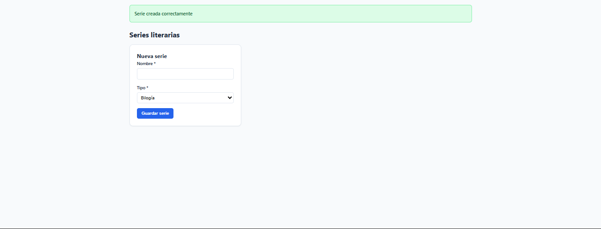
Vista de series:
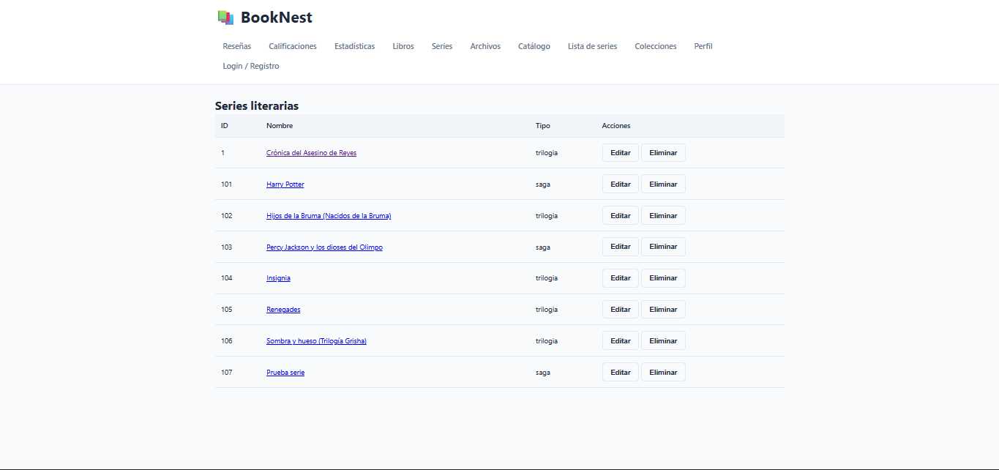
Asociación con libros:
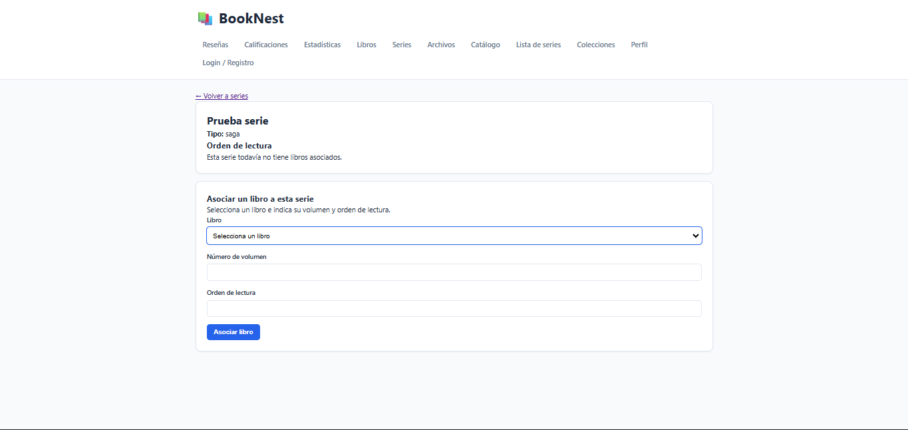
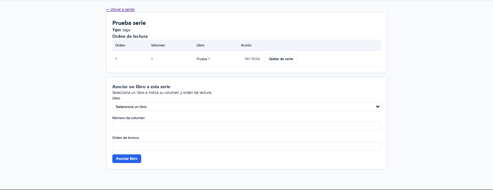
## Consultar la ficha bibliográfica y sus datos
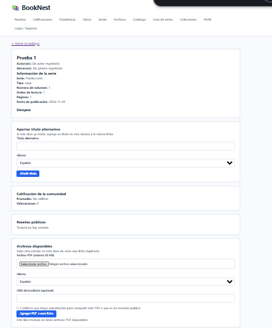
## Agregar un PDF a una ficha existente
Pdf de prueba subido:
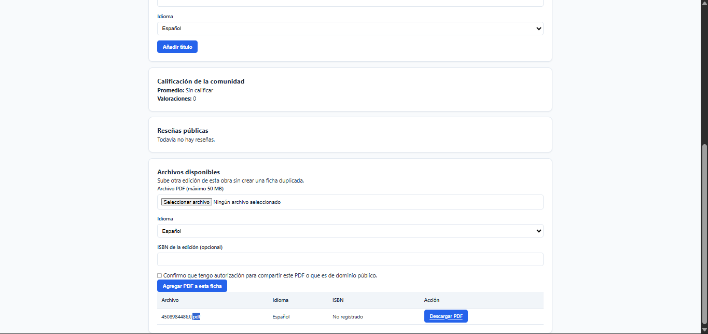
## Eliminar un libro sin dependencias y comprobar las restricciones
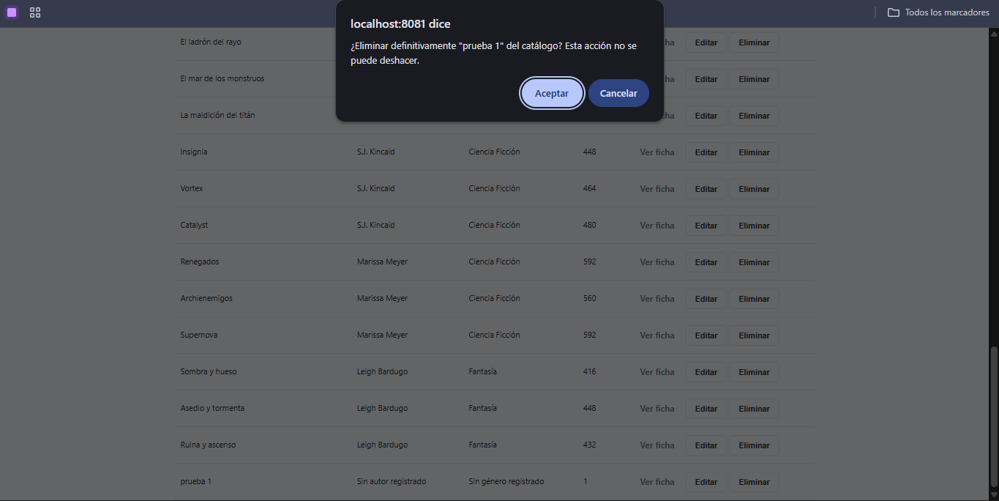
    _y se borra_