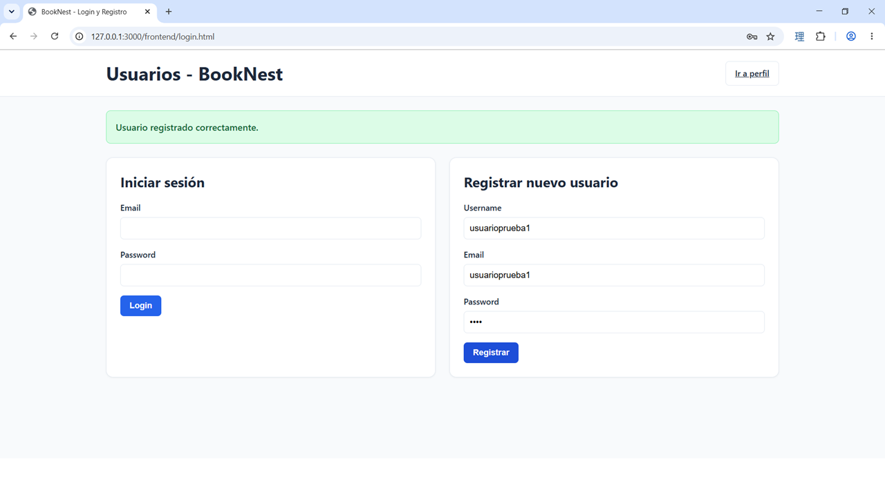
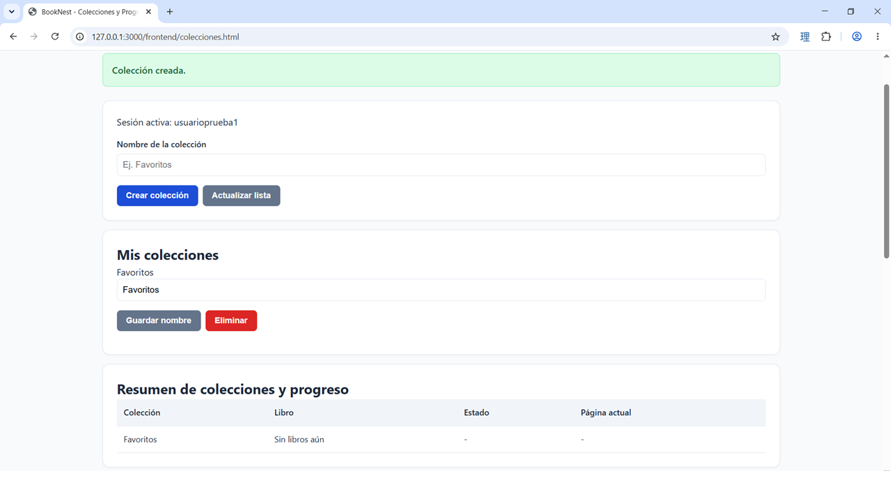
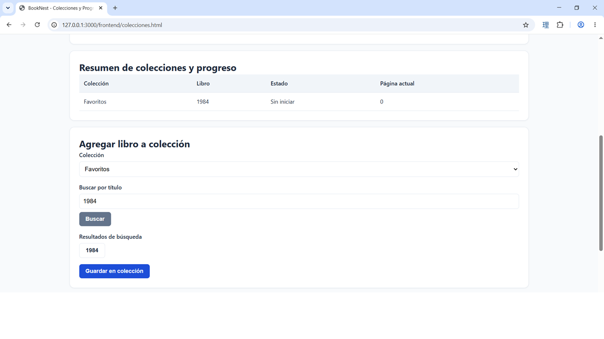
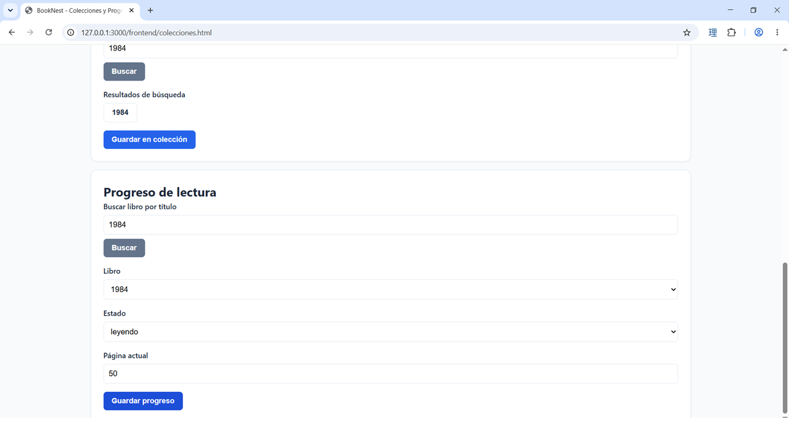
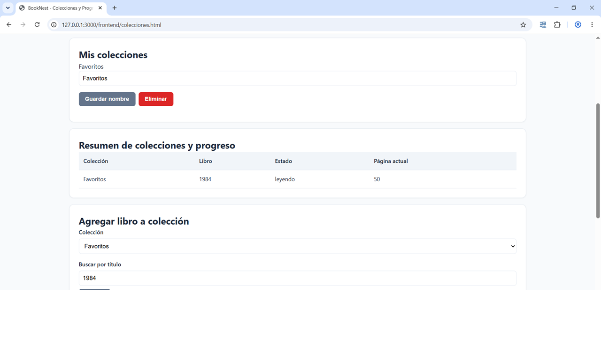

# Frontend - Cuarta/Quinta entrega
_**Responsable**: Juan Luis Gaona Aguirre_

### Prueba 1:
Crear usuario e iniciar sesión

### Prueba 2:
Crear coleccion del usuario. Esta no se puede crear si no estas logueado

### Prueba 3:
Busca libros y los agrega a la coleccion

### Prueba 4:
Registra progreso de lectura individual

### Prueba 5:
Coleccion con libros y su progreso
