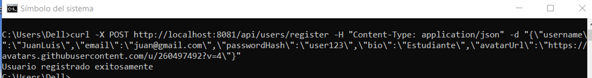
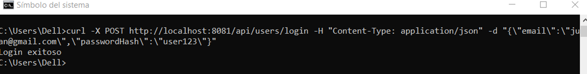
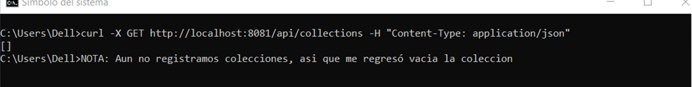
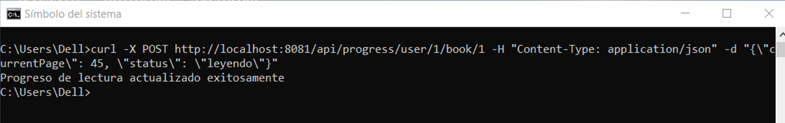
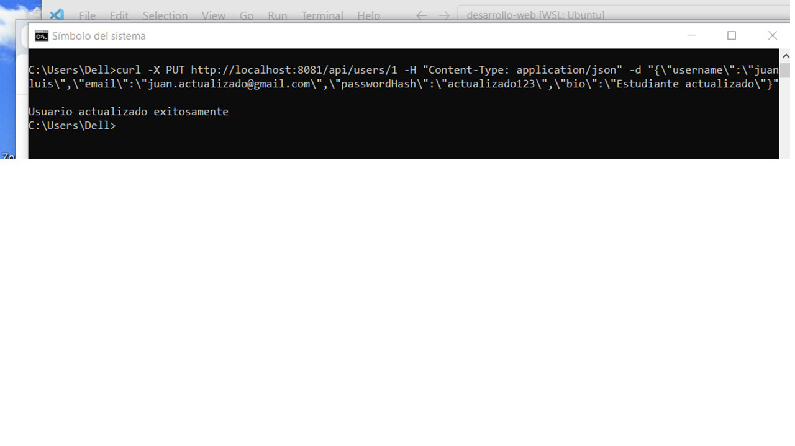
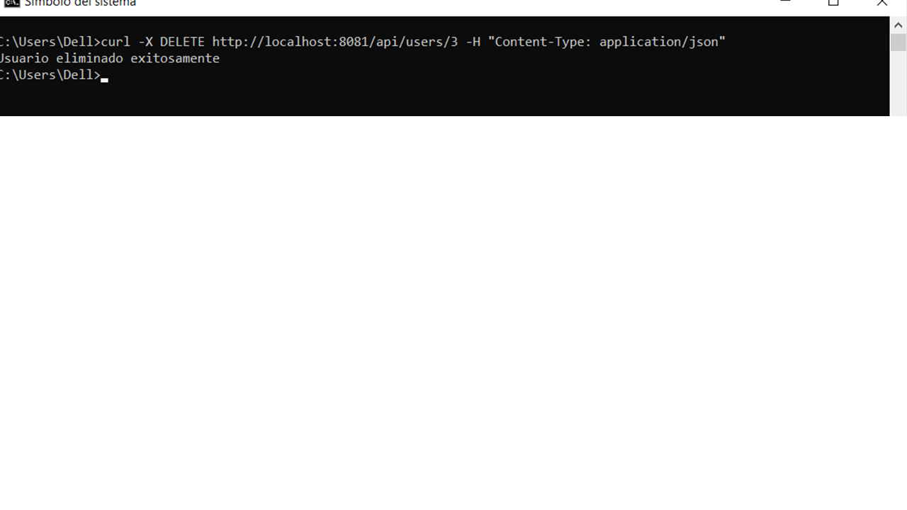
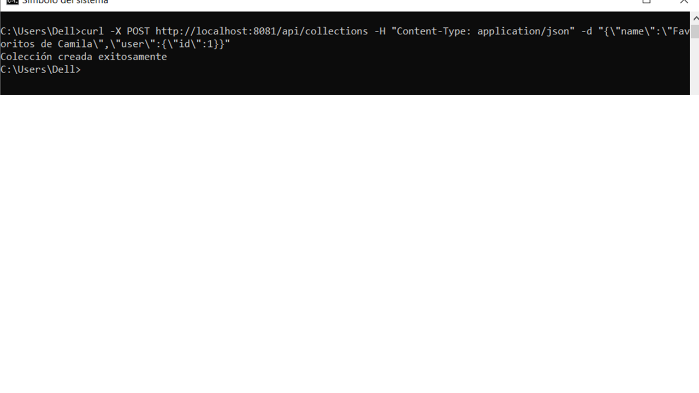
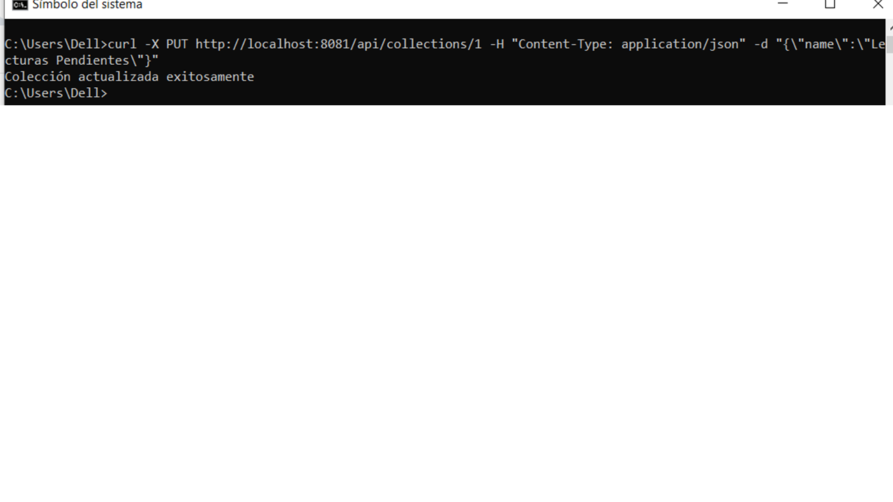
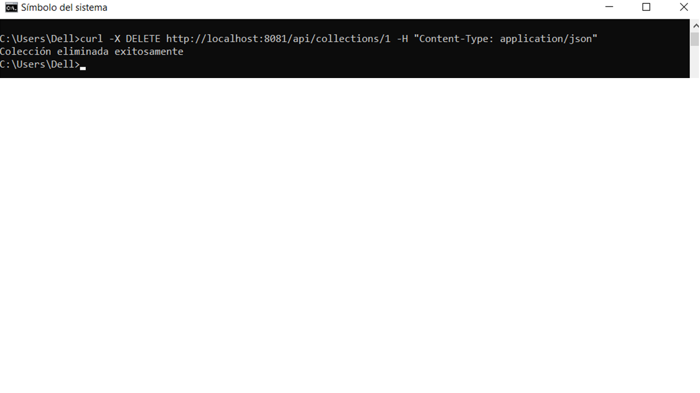

# CURL - Segunda Entrega
## POST y GET Géneros
_**Responsable**: Juan Luis Gaona Aguirre_

### Prueba 1:
curl -X POST http://localhost:8081/api/users/register -H "Content-Type: application/json" -d "{\"username\":\"JuanLuis\",\"email\":\"juan@gmail.com\",\"passwordHash\":\"user123\",\"bio\":\"Estudiante\",\"avatarUrl\":\"https://avatars.githubusercontent.com/u/260497492?v=4\"}"

### Prueba 2:
curl -X POST http://localhost:8081/api/users/login -H "Content-Type: application/json" -d "{\"email\":\"juan@gmail.com\",\"passwordHash\":\"user123\"}"

### Prueba 3:
curl -X GET http://localhost:8081/api/collections -H "Content-Type: application/json"

### Prueba 4:
curl -X POST http://localhost:8081/api/progress/user/1/book/1 -H "Content-Type: application/json" -d "{\"currentPage\": 45, \"status\": \"leyendo\"}"

# CURL - Tercera Entrega
## DELETE y PUT Géneros
### Prueba 5:
curl -X PUT http://localhost:8081/api/users/1 -H "Content-Type: application/json" -d "{\"username\":\"juanluis\",\"email\":\"juan.actualizado@gmail.com\",\"passwordHash\":\"actualizado123\",\"bio\":\"Estudiante actualizado\"}"

### Prueba 6:
curl -X DELETE http://localhost:8081/api/users/3 -H "Content-Type: application/json"

### Prueba 7:
curl -X POST http://localhost:8081/api/collections -H "Content-Type: application/json" -d "{\"name\":\"Favoritos de Camila\",\"user\":{\"id\":1}}"

### Prueba 8:
curl -X PUT http://localhost:8081/api/collections/1 -H "Content-Type: application/json" -d "{\"name\":\"Lecturas Pendientes\"}"

### Prueba 9:
curl -X DELETE http://localhost:8081/api/collections/1 -H "Content-Type: application/json"

