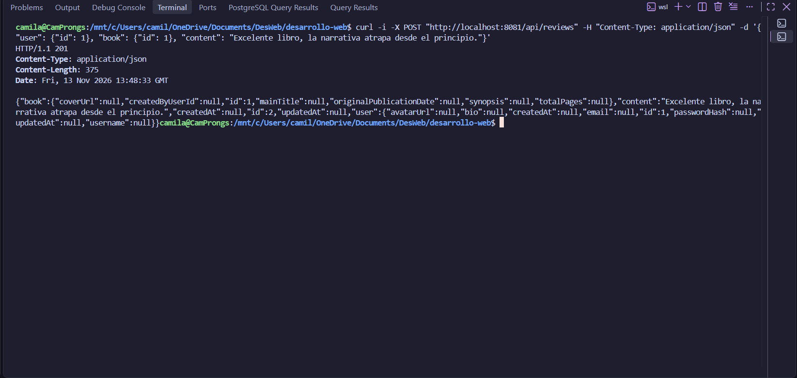
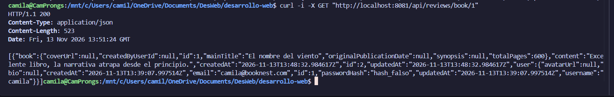
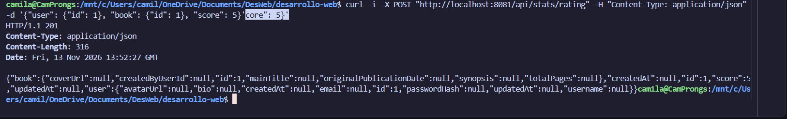
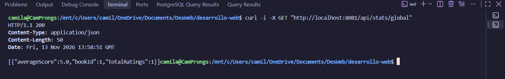

# CURL - Segunda Entrega
## Módulo: Reseñas y estadísticas
_**Responsable**: Camila Mariné Crespo Zurita_

### Crear una reseña
\`\`\`bash
curl -i -X POST "http://localhost:8081/api/reviews" -H "Content-Type: application/json" -d '{"user": {"id": 1}, "book": {"id": 1}, "content": "Excelente libro, la narrativa atrapa desde el principio."}'
\`\`\`

### Obtener reseñas de un libro
\`\`\`bash
curl -i -X GET "http://localhost:8081/api/reviews/book/1"
\`\`\`

### Crear una calificación
\`\`\`bash
curl -i -X POST "http://localhost:8081/api/stats/rating" -H "Content-Type: application/json" -d '{"user": {"id": 1}, "book": {"id": 1}, "score": 5}'
\`\`\`

### Obtener promedios globales
\`\`\`bash
curl -i -X GET "http://localhost:8081/api/stats/global"
\`\`\`
